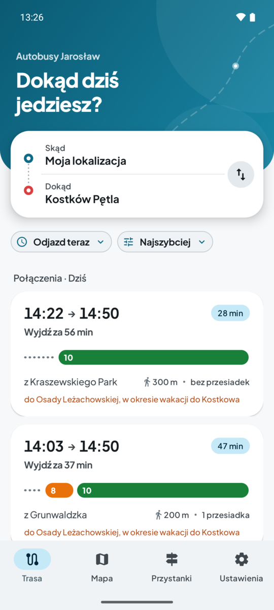
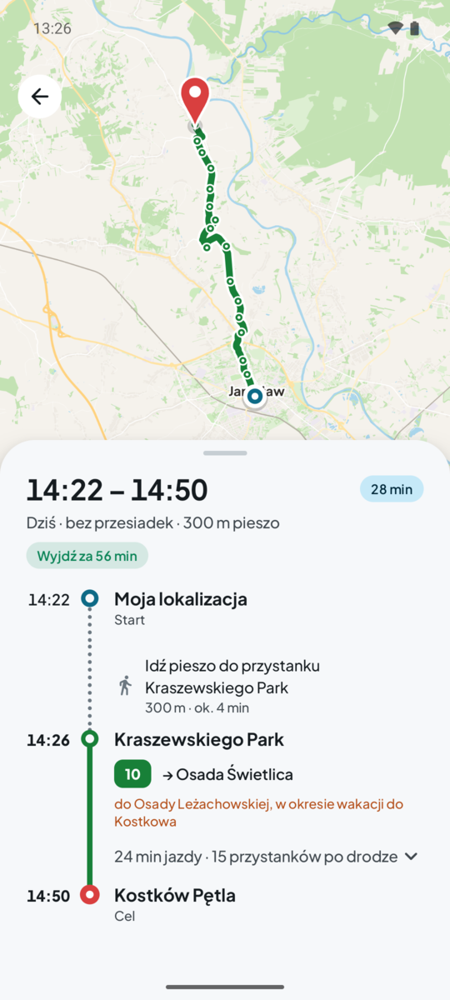
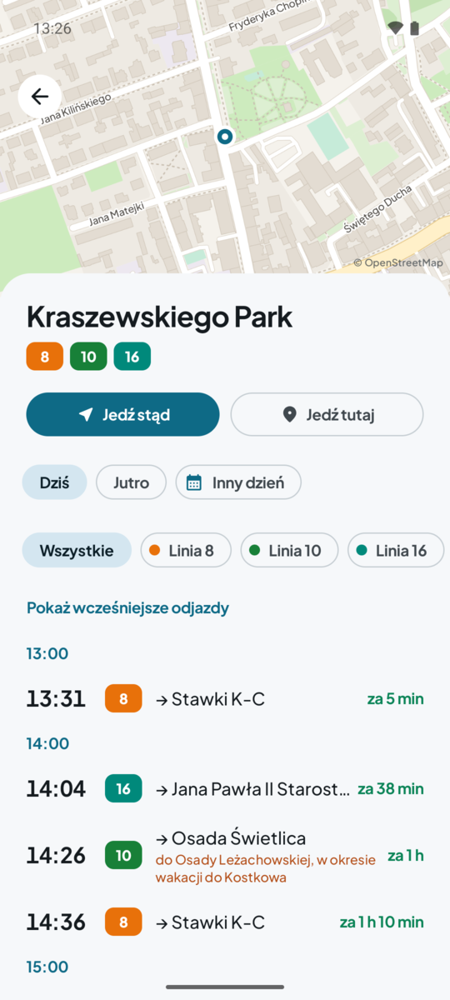
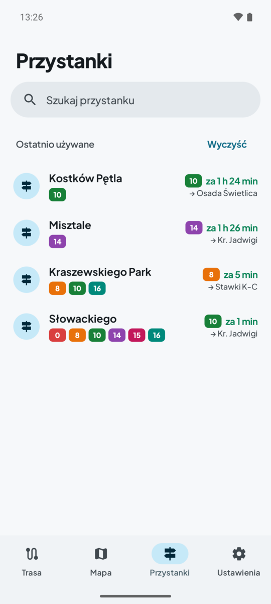
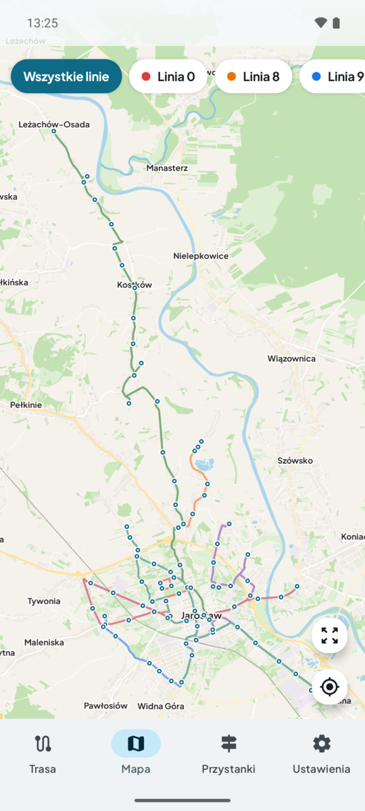
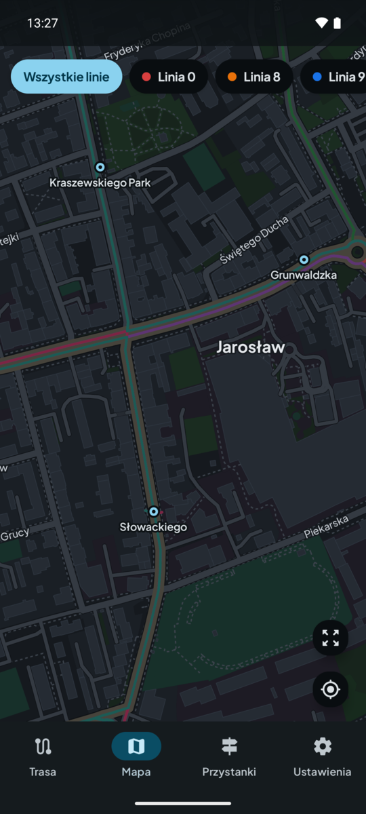

<h1>Autobusy Jarosław</h1>

**Bus timetable and journey planner for Jarosław.**<br>Which bus, from where, and when to leave the house.

<br clear="left">

[](#building)
[](https://kotlinlang.org)
[](https://developer.android.com/compose)
[](LICENSE)

PWiK publishes the city bus timetable as one long PDF table. Fine on a computer, a pain on a phone when all you want is the next bus. This app reads that PDF and turns it into a proper planner: pick where you're going and it tells you which bus to take, where to catch it and when to leave.

<table>
  <tr>
    <td align="center"><br><b>Plan a trip</b></td>
    <td align="center"><br><b>See the whole journey</b></td>
    <td align="center"><br><b>Departures from any stop</b></td>
  </tr>
  <tr>
    <td align="center"><br><b>Your stops, next buses</b></td>
    <td align="center"><br><b>The whole network</b></td>
    <td align="center"><br><b>Dark mode</b></td>
  </tr>
</table>

## Features

<table>
  <tr>
    <td width="50%" valign="top">
      <b>Journey planner</b><br>
      Start from where you are, a stop, a street or any spot on the map. Direct buses and transfers, walking included, with a "leave in 12 min" countdown that keeps itself current.
    </td>
    <td width="50%" valign="top">
      <b>Departure boards</b><br>
      Every bus from a stop for today, tomorrow or any date you pick. Filter by line to see only the one you take.
    </td>
  </tr>
  <tr>
    <td width="50%" valign="top">
      <b>Network map</b><br>
      Every stop and route on one smooth map. Pick a line to see only its route, tap a stop for its next departures.
    </td>
    <td width="50%" valign="top">
      <b>Your stops first</b><br>
      Search opens with the stops and places you actually use, not a fixed list.
    </td>
  </tr>
  <tr>
    <td width="50%" valign="top">
      <b>Works offline</b><br>
      The map of Jarosław and the nearby villages is built in, and the timetable stays on the phone after the first download. Once a month the app checks the PWiK website for a new one by itself.
    </td>
    <td width="50%" valign="top">
      <b>Knows the school year</b><br>
      Trips that only run on school days or in the summer show up on the right days, holidays and the Podkarpackie winter break included.
    </td>
  </tr>
</table>

## Building

Needs the Android SDK (platform 37) and JDK 17 or newer.

```sh
./gradlew :app:assembleRelease
```

The APK lands in `app/build/outputs/apk/release/`. Release builds are signed with the key set in `~/.gradle/gradle.properties` (`pwikStoreFile`, `pwikStorePassword`, `pwikKeyAlias`, `pwikKeyPassword`), and come out unsigned if those aren't set.

## License

The code is licensed under [GPL-3.0](LICENSE).

Timetable © PWiK Sp. z o.o. w Jarosławiu. Map data © [OpenStreetMap](https://www.openstreetmap.org/copyright) contributors, ODbL. Font: [Plus Jakarta Sans](https://github.com/tokotype/PlusJakartaSans), SIL Open Font License.

<br>

<div align="center"><sub>Made by kotwicha · not an official PWiK app</sub></div>
